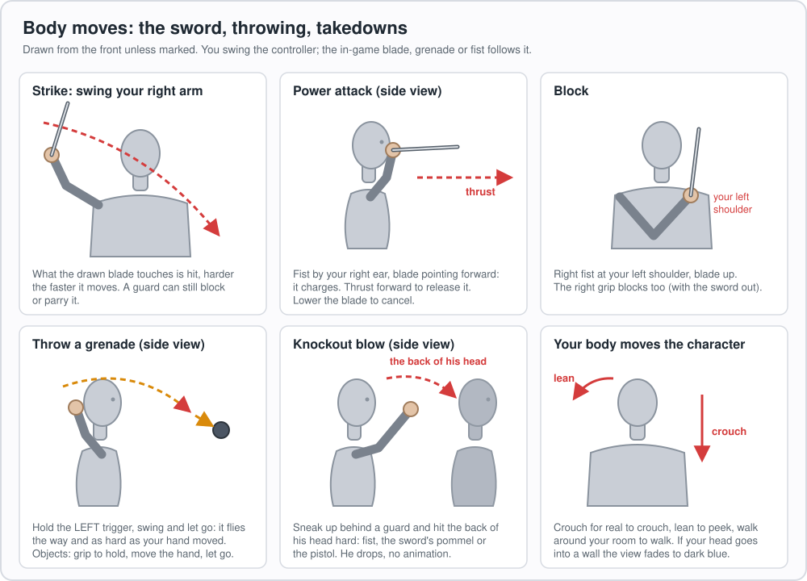
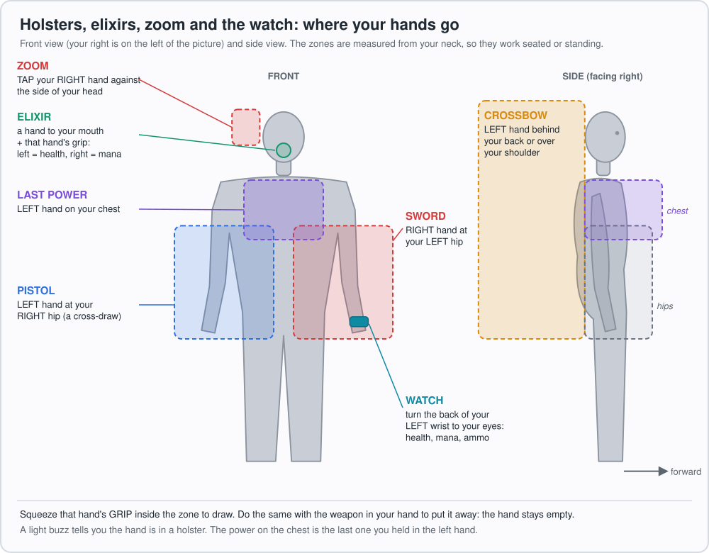
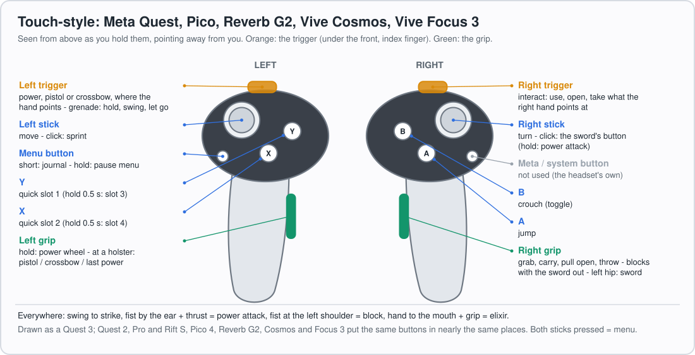
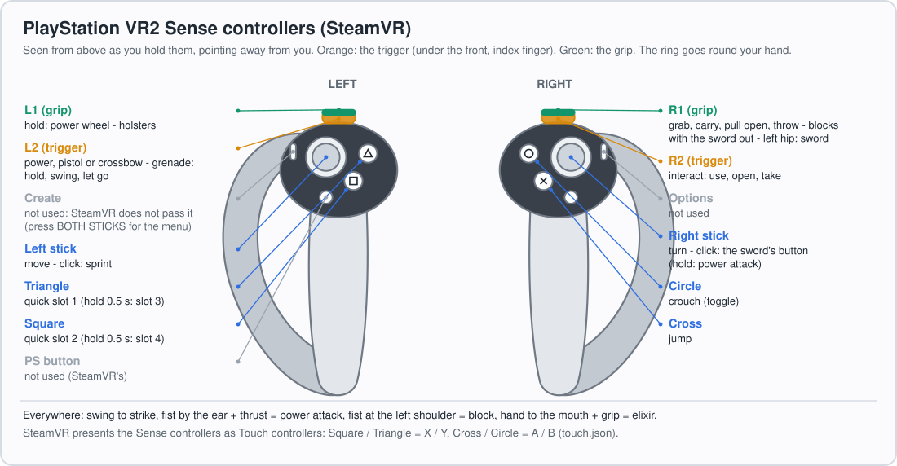
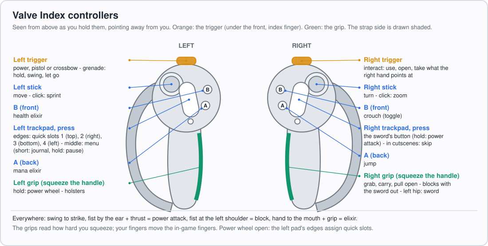
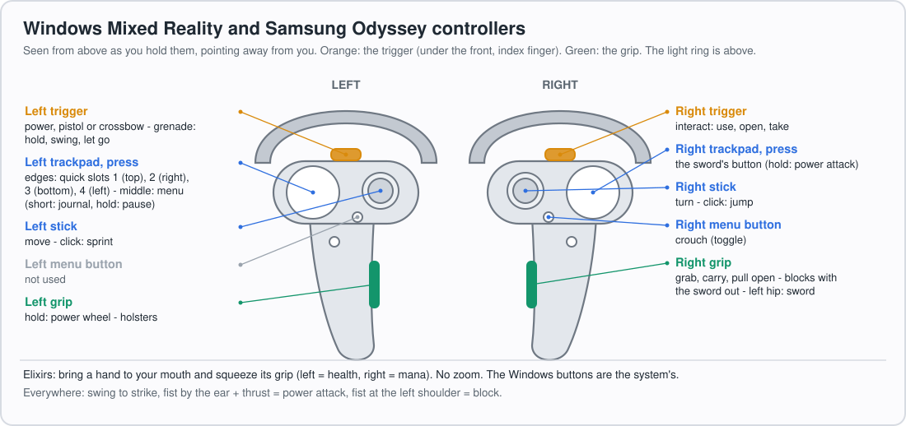
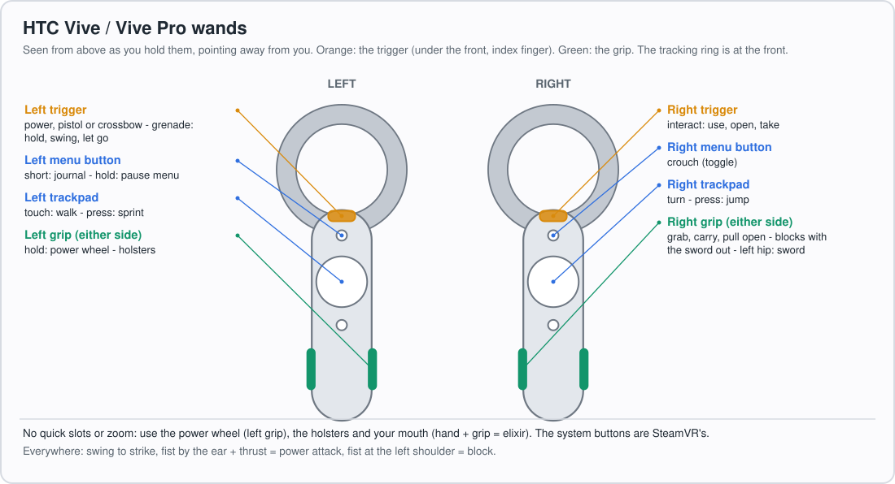

# Dishonored 2 VR

A native VR mod for **Dishonored 2** (Arkane Studios, 2016): play the whole game in a PC VR headset with motion
controllers. Free, open source, unofficial.

This mod is only possible thanks to the initial work by **The Cosmic Tangerine**, whose original Dishonored 2 VR mod
it builds on.

- **The view follows your head** in 6DOF; walk around your room, lean, peek and crouch with your body.
- **Two independent hands**: in the flat game both hands are armed or both are empty; here each hand is drawn and
  holstered on its own. The sword goes in the right, the pistol, crossbow, powers and grenades in the left, each one
  aimed exactly where that hand points, on full arms with inverse kinematics.
- **A physical sword**: the blade hits what it touches, harder the faster you swing; gestures charge the power attack
  and block.
- **Knockout blows, a new game mechanic**: sneak up behind a guard and knock him out by hand with a blow to the back
  of his head, a VR-friendly non-lethal takedown with no choke animation. The game's own takedowns from behind still
  work too.
- **Solid hands and weapons** that stop at walls and push loose objects; push doors, pull drawers open, slide windows,
  turn safe dials, take items and eat food by hand.
- **Holsters on your body**, elixirs drunk at your mouth, grenades thrown with your arm's motion.
- **Real stereo 3D** at the headset's full refresh, menus on a big screen in the room, the HUD as a watch on your
  wrist, and cutscenes played around you.

> **Release coming soon: no build is available to download yet.**
>
> Status: **0.5.0, beta**. Developed on a Meta Quest 3 (Link / Air Link) and played on SteamVR with a Bigscreen
> Beyond 2 and a Pimax using Valve Index controllers. Other headsets and controllers have their own profiles and are
> expected to work, but are less tested: see [docs/STATUS.md](docs/STATUS.md) for what is verified, and the known
> issues.

## Contents

- [Install](#install) and [Requirements](#requirements)
- [Known limitations](#known-limitations)
- [Features](#features)
  - [Your body](#your-body)
  - [Two independent hands](#two-independent-hands)
  - [The sword](#the-sword)
  - [Takedowns and knockout blows](#takedowns-and-knockout-blows)
  - [Pistol, crossbow and powers](#pistol-crossbow-and-powers)
  - [Throwing](#throwing)
  - [Holsters](#holsters)
  - [Solid hands and weapons](#solid-hands-and-weapons)
  - [Your hands in the world](#your-hands-in-the-world)
  - [HUD, menus and cutscenes](#hud-menus-and-cutscenes)
  - [Comfort and reliability](#comfort-and-reliability)
  - [Cheats](#cheats)
- [Controls](#controls)
  - [Gestures (every controller)](#gestures-every-controller)
  - [Touch-style controllers](#touch-style-controllers-quest-rift-pico-reverb-g2-vive-cosmos-vive-focus-3)
  - [PlayStation VR2](#playstation-vr2-sense-controllers)
  - [Valve Index](#valve-index)
  - [Windows Mixed Reality](#windows-mixed-reality-and-samsung-odyssey)
  - [Vive wands](#htc-vive--vive-pro-wands)
  - [In menus](#in-menus)
- [Settings](#settings)
- [Advanced: how it works](#advanced-how-it-works)
  - [Stereo rendering](#stereo-rendering)
  - [Performance optimizations](#performance-optimizations)
- [For developers and modders](#for-developers-and-modders)
- [License and credits](#license-and-credits)

## Install

1. Download `DishonoredVR-<version>.zip` from the [Releases](../../releases) page (coming soon: there is no release
   yet).
2. In Steam: right-click Dishonored 2 > Manage > Browse local files (the folder with `Dishonored2.exe`).
3. Copy `dinput8.dll`, `DishonoredVR.dll`, `DishonoredVR.ini` and the `VRControllerBindings` folder into that folder.
4. Make your headset's app the active OpenXR runtime (Meta Horizon Link app, Virtual Desktop's VDXR, or SteamVR >
   Settings > OpenXR).
5. Set the game to **windowed** mode, start it from Steam, click the game's window once so it is in front, and put the
   headset on. VR switches on by itself a moment after you are in control of your character.

The zip's `README.txt` has everything for players: setup, the controls, every setting and troubleshooting. To
uninstall, delete those files (the game itself is never modified).

### Requirements

| | |
|---|---|
| Game | **Dishonored 2 on Steam**, current build (1.77.9.0). Not GOG, not Microsoft Store / Game Pass, not *Death of the Outsider* (the mod detects them and stays off). |
| OS | Windows 10 or 11, 64-bit. Nothing else to install. |
| Headset | Any PC VR headset with an OpenXR runtime. Tested: Meta Quest 3 over Link / Air Link; Bigscreen Beyond 2 and Pimax on SteamVR with Index controllers. Expected to work: other Quests, Virtual Desktop, other SteamVR headsets, WMR, Pico, Vive (see [STATUS](docs/STATUS.md)). |
| Display mode | Windowed (not fullscreen or borderless). |
| Graphics | A PC that runs VR. Fixed foveated rendering (optional) needs an NVIDIA card. |

## Known limitations

**Performance is the biggest limitation.** Dishonored 2 is hard to run at a full, steady frame rate even as a flat
game, and VR asks far more of it: every game tick is drawn twice (once per eye), at the headset's resolution, which is
much higher than a monitor's. At 90 Hz that is 90 stereo pairs, or 180 rendered frames, every second.

Tested on an **NVIDIA RTX 5090 with an AMD Ryzen 7 9800X3D**, the game still had a hard time holding a constant 90 fps
(stereo pairs), despite the many optimizations the mod employs (see
[Performance optimizations](#performance-optimizations)). Expect to tune it for your PC:

- Turn on the **FPS counter** (VR Performance tab, or `FpsCounter` in the ini): green at the headset's refresh rate,
  amber below it, red under three quarters of it.
- Try the settings in the **VR Performance** and **VR Display** tabs and the game's own graphics options (shadows,
  view distance, detail) and watch the counter.
- The biggest lever is most likely the **rendering resolution**: lower `RenderScale` (for example 0.8), or the
  resolution in your headset's PC app (SteamVR's per-application resolution, the Meta Horizon Link app, Virtual
  Desktop).

Known bugs (to be fixed):

- **The final Void area in Delilah's world renders incompletely.**
- **The Timepiece in A Crack in the Slab:** the view of the other era through its lens is not in stereo yet (both eyes see the same flat picture).

Other limitations:

- Only the current **Steam** build of Dishonored 2, in **windowed** mode, is supported; the game window must stay in
  front on the PC (the mod keeps it there).
- Most testing was on a Quest 3 and on SteamVR with Index controllers; other headsets and controllers have profiles
  but are less tested.
- [docs/STATUS.md](docs/STATUS.md) lists every known issue, and what is verified and what is not.

## Features

### Your body

- **6DOF head.** The view follows your head's position and rotation; the left stick walks where you look.
- **Roomscale.** Walking around your room walks the character with you, so you rarely need to recentre. The game's
  collision stops the character at walls and furniture; leans under 10 cm leave it where it is.
- **Physical crouch.** Crouch for real and the character crouches (stealth, low passages); stand up to stand. The view
  stays at your real head's height. How deep counts as crouching is a setting (`PhysicalCrouchDepth`, 30 cm).
- **Lean and peek** with your body: there is no lean button.
- **Wall fade.** If your head goes into a wall, floor or door, the headset fades to dark blue until you step back out,
  instead of showing the inside of the level.
- **Camera pitch fix.** The game's camera no longer slides forward and back as you look down and up.

### Two independent hands

Each hand is its own weapon slot, as in a game made for VR. In the flat game the hands go together: both are empty
(weapons sheathed) or both are equipped. Here each hand is armed or empty on its own: draw or holster either one
independently (see [Holsters](#holsters)), so you can hold the sword with an empty left hand, or a power or the
pistol with an empty right hand.

- **Right hand:** the sword, interacting (the right trigger uses what the right hand points at), grabbing and carrying.
- **Left hand:** powers, the pistol, the crossbow, grenades, springrazors, mines.
- **Each one aims where it points.** A shot leaves along the pistol as you hold it, a bolt along the crossbow, a power
  from your palm, a mine lands where your hand points. Two pointers (optional, shown as small dots by default) show
  where each hand points; the right one grows on something you can take or use.
- **Full arms** reach your controllers with inverse kinematics; the hands grip what they hold, learned per weapon.
- **A hand you empty stays empty** until you put something in it: choosing a power, a quick slot, blocking, swinging
  or being stunned no longer pulls the sword back into your right hand.
- **Finger tracking** (Valve Index): the in-game fingers of an empty hand or a hand holding a power open and close
  with yours, each finger on its own.

### The sword

- **Swing to strike.** What the blade touches is hit, at once and harder the faster it moves (`SwordDamageScale`, 1 =
  a firm swing does what the game's attack does). A guard who is blocking still blocks or parries it, as in the game.
- **Power attack:** fist by your right ear with the blade forward, then thrust. Lower the blade to cancel it.
- **Block:** bring your right fist, holding the sword with the blade up, to your left shoulder (within about 20 cm);
  you block for as long as it stays there. Or squeeze the right grip with the sword out. The gesture is off while you
  are crouched (sneaking), where the grip still blocks.
- **No finishing-move animations or kill cam:** a blow that would trigger one is an ordinary blow that still lands, so
  the view never leaves your head. Stealth takedowns keep theirs.
- **Bloodflies** are easier to hit (the blade reaches 30 cm further for them), and their nests can be struck too.
- The sword's button (Touch: right stick click; Index and WMR: right trackpad) still plays the game's own attack.

### Takedowns and knockout blows

- **The takedown marker:** sneak up behind a guard who has not seen you and a small **red-and-blue marker** appears on
  the back of his neck: a takedown is possible. (The pointers stay white.)
- **Lethal (red):** swing the sword at him for the game's stealth kill. The game's non-lethal choke is still on the
  block button.
- **Knockout blow (new, blue):** a game mechanic of the mod's own, not in the original game. It is a VR-friendly way to
  take someone out non-lethally with your own hands, instead of a choke animation that takes the view and your hands
  away. Hit the marker firmly with your fist (open or closed), the sword's pommel or the pistol and he is knocked out
  at once.
  - How hard: `KnockoutSpeed` (8 m/s in the shipped ini; a firm punch is about 4 to 6 m/s).
  - How squarely behind him (60° off straight behind) and how close to his head (30 cm) are hidden settings.
  - A hit sound plays (`KnockoutSoundVolume`); put your own `DVR_knockout.wav` in the game folder to replace it.

### Pistol, crossbow and powers

- The **left trigger** fires the pistol or crossbow, or casts the power in your left hand, where the hand points.
- Powers come out of your hand: Blink, Far Reach, Domino, Mesmerize and the rest go where your left hand points.
- The **power wheel** (hold the left grip) opens on a panel in front of you while the world stays put: pick with the
  stick, let go to equip.
- **Zoom (the mask's spyglass):** tap your right hand against the side of your head. Tap again for more zoom once
  the spyglass is upgraded, again to go back. The zoomed view is in stereo, and your hands' pointers aim
  in it, so you can line up a shot through the zoom.

### Throwing

- **Grenades and springrazors:** hold the left trigger, swing your arm and let go. It leaves your hand at that moment,
  the way and as hard as your hand was moving. The mod waits for the game to light the fuse before it lets go, so a
  quick throw is never a dud. The game's throw animation is cut short, so the next grenade is in your hand a moment
  later (with a light buzz); pull the trigger before then and the mod holds it until that moment.
- **Objects:** take a bottle or a cup with the right grip and let go while moving your hand to throw it.

### Holsters

Squeeze a grip with your hand at a holster to draw what is there; do it again with the weapon in that hand to put it
away. A light buzz tells you when the hand is at a holster.

| Hand | Where | What |
|---|---|---|
| Right | Left hip | The sword |
| Left | Right hip | The pistol |
| Left | Behind your back or over your shoulder | The crossbow |
| Left | Your chest | The last power you used |
| Left | Your mouth | Drink a health elixir |
| Right | Your mouth | Drink an Addermire Solution (mana) |

The zones follow your body, not the headset: the torso turns with your head only once you look more than 35° to one
side, so you can look around and still find your hips.

### Solid hands and weapons

- **Your hands stop at the world:** walls, tables, props and people (with a buzz), and catch up when you pull back.
  Reach far through a wall and the hand lets go and follows you.
- **So do the sword and the guns.** The blade also stops at people's bodies after sinking in a little (4 cm); the hit
  still lands from your real swing.
- **Pushing:** hands and weapons push loose objects (bottles, chairs, crates) as if the hand weighed about a kilogram.

### Your hands in the world

- **Doors:** push a closed door with either hand to open it, push an open one to close it.
- **Drawers and cabinets:** put your hand on one, squeeze the grip and pull back to open it; push it shut. Locks and
  keys work as in the game.
- **Windows:** rest a hand on a sliding window and slide it up or down.
- **Safes:** slide your right hand up or down a number wheel to turn it a digit (about 3.5 cm per digit). The safe
  opens on the right combination as usual.
- **Taking items by hand:** touch an item (coins, ammo, elixirs, runes, bone charms, keys, blueprints...) with your
  right hand, squeeze the grip, and reach behind you (over your shoulder or behind your back) to keep it. If the game
  will not take it, or you let go, it goes back where it was. Notes and books are read with interact, which still takes
  any item from afar too.
- **Eating and drinking:** bring food to your mouth to eat it; bring a hand to your mouth and squeeze to drink an elixir
  (left = health, right = mana).
- **Grab and carry objects** with the right grip: an object stays in your hand while you hold the grip. Bodies are
  picked up the game's own way, onto your shoulder, not held in your hand.

### HUD, menus and cutscenes

- **Stereo HUD:** the game's interface on one layer for both eyes at 2 m, not doubled, with its edges brought inward
  (`HudScale`).
- **Markers in the world:** a guard's alert marker and the objective markers float over the characters, at their
  distance.
- **Wrist watch:** look at the back of your left wrist, like checking a watch, for health, mana and the equipped item
  with its ammo.
- **Menu screen:** menus, loading screens, the journal, the shops and the character choice show on a big screen fixed
  in the room. While paused, the world stops and dims around it.
- **VR options in the game:** Options has VR tabs (VR Controls, VR Gameplay, VR Display, VR Performance, VR
  System / Cheats) after the game's own, each setting showing its recommended value.
- **FPS counter** (optional) in a corner of your view: green at the headset's refresh, amber below, red under three
  quarters of it.
- **Cutscenes play around you:** look anywhere with your head (a train or boat you ride turns you with it), no black
  bars, and your own hands. Hold the skip button (Touch: A or X; Index: the right trackpad) to skip.

### Comfort and reliability

- **Turning:** snap (20° steps by default, with a short dim during each snap) or smooth (120°/s).
- **Far Reach VR comfort option** (`FarReachVRComfortOption`, on by default, in the VR Gameplay options): Far Reach puts you where it
  landed at once instead of pulling you through the air. Where it takes you is unchanged.
- **No motion blur or depth of field** in VR; Meta's ASW is switched off for the game on Link / Air Link.
- **A tidier game Options menu:** in VR the game's own Options screens leave out the settings the mod decides there:
  field of view, adaptive resolution, triple buffering, V-Sync and the frame-rate limiter (the headset paces the
  game), depth of field, motion blur, fog blur, HBAO+ (with `AmbientOcclusion = 0`), view distance (the VR options'
  `ViewDistance`), the crosshair (the hands' reticles replace it) and the kill cam (with `FinisherAnimations = 0`).
- **The game window is kept in front:** the controllers drive the game's keyboard and mouse, which Windows gives only
  to the window in front. The mod brings the game back when you press a button or put the headset on, and raises it
  when another window covers it.
- **The headset never freezes:** during a hitch or a load the headset keeps showing the last picture held in the room;
  a session the runtime stops is restarted by itself; a disconnected headset leaves the normal flat game running and
  VR comes back when it reconnects.
- **Haptics** for holsters, the mouth, touching the world and drinking.

### Cheats

Optional, in the VR System / Cheats tab or the ini. InfiniteMana, InfiniteAmmo and InfiniteHealth are on in the
shipped ini. `UnlockEverything` gives the Outsider's mark, every upgrade, bone charm crafting, black market upgrade
and weapon; the powers are switched on one by one (`[Cheats.Powers]`: Blink, Far Reach, Dark Vision, Possession,
Devouring Swarm, Bend Time, Windblast, Domino, Doppelganger, Mesmerize, Shadow Walk). The game saves what the cheats
change: use saves you do not mind changing.

## Controls

Every controller plays the same way (the Valve Index's layout): **right trigger interacts, the grips are your hands,
the sword strikes by swinging**. Only the buttons differ, so each controller class has a picture below. The profile
for your controllers is picked by itself (`ControllerBindings = auto`; the log says which); each one is a file in
`VRControllerBindings\` whose `notes` explain its settings.

### Gestures (every controller)

| Do this | And |
|---|---|
| Swing your right arm | Strike with the sword |
| Fist by your right ear, blade forward, then thrust | Power attack (lower the blade to cancel) |
| Right fist at your left shoulder, blade up (or the right grip, sword out) | Block |
| Hit the back of a guard's head, from behind | Knock him out |
| Left trigger held, swing, let go | Throw a grenade or springrazor |
| A grip at a holster | Draw / put away (see [Holsters](#holsters)) |
| A hand to your mouth + its grip | Drink an elixir (left health, right mana), eat what it holds |
| Tap your right hand against the side of your head | Zoom; again: zoom in more (upgraded spyglass); again: back to normal |
| Look at the back of your left wrist | The watch: health, mana, ammo |
| Crouch, lean, walk for real | The character does too |

### Touch-style controllers: Quest, Rift, Pico, Reverb G2, Vive Cosmos, Vive Focus 3

- Profiles: `touch.json` (Meta Quest 1 / 2 / 3 / Pro and Rift on Link, Air Link, Virtual Desktop or SteamVR),
  `pico.json`, `hp_reverb_g2.json`, `vive_cosmos.json`, `vive_focus3.json`. The picture is a Quest 3; the others put
  the same buttons in nearly the same places (the Reverb G2's menu button sits below the stick, next to its Windows
  button).
- Y and X are quick slots 1 and 2; hold them half a second (the controller buzzes) for slots 3 and 4
  (`QuickSlotHoldTime`).

### PlayStation VR2 Sense controllers

- Through SteamVR (the PC adapter), which presents them as Touch controllers (`touch.json`): Triangle / Square =
  Y / X, Circle / Cross = B / A, L1 / R1 = the grips, L2 / R2 = the triggers.
- SteamVR does not pass the Create button to the game: press both sticks together for the journal and pause menu, or
  bind Create in SteamVR's controller bindings for Dishonored 2.

### Valve Index

- Profile: `index.json`. The grips react to how hard you squeeze them (`GripThresholdLeft` / `Right`), not to fingers
  resting on them. If you changed the game's bindings in SteamVR, reset them there.
- The trackpads count a press by force (`PadPressForce`); the left pad's middle (`PadCenterRadius`) is the menu
  button, its edges the four quick slots.
- `FingerTracking`: your fingers move the in-game fingers.

### Windows Mixed Reality and Samsung Odyssey

- Profile: `wmr.json`. No A / B / X / Y, so the trackpads take the Index's roles; the right stick click jumps and the
  right menu button crouches. Elixirs are drunk at the mouth. No zoom.

### HTC Vive / Vive Pro wands

- Profile: `vive_wands.json`. The left trackpad walks, the right one turns; there are not enough buttons for the quick
  slots or zoom: use the power wheel, the holsters and your mouth.

### In menus

| Control | Does |
|---|---|
| Sticks (Index: also the left trackpad's edges) | Move |
| A | Select |
| B or the menu button | Back |
| Grips | Next / previous tab |
| Triggers | Previous / next sub-tab |
| Click either stick | Bring the menu screen in front of you (it also comes by itself when you look away) |

In a shop, A buys, the grips switch Ammunition / Items and B goes back out; the new game's character choice is picked
with left / right and confirmed with A.

## Settings

`DishonoredVR.ini` sits next to the game's exe; most settings can also be changed in the game's Options, in the VR
tabs. Going back from a VR tab after a change asks whether to apply it: Yes writes the ini and applies it at once
(except the few marked "restart").

- The file is in main groups (`[Display]`) and subgroups (`[Display.Fog]`). Each setting is explained above its line
  and marked `@user` (shown in the VR tabs, with its recommended value) or `@hidden` (tuning, experiments and
  troubleshooting, last in each subgroup).
- **Core VR** features (the physical sword, knockout blows, collision, grabbing, holsters, roomscale, the watch, the
  menu screen...) are always on, as in a game made for VR. Their switches stay in the file, hidden and marked "Core
  VR", for troubleshooting only.
- Per-controller settings (grip thresholds, quick slot hold time, finger tracking, controller pitch offset, trackpad
  forces) live in the controller's profile in `VRControllerBindings\`; any ini setting can be put there too and wins
  over the ini.
- Deleting a line, or the whole file, gives the default back.

## Advanced: how it works

A `dinput8.dll` proxy loads `DishonoredVR.dll` into the game. The game is never asked to "be a VR game": it keeps
rendering one flat frame per Present from one camera. The mod changes the pipeline's inputs and outputs:

1. **The view.** The engine builds the main view's matrix in one small function. Hooking it moves the whole scene by
   the head's offset without touching game state. The rotation stays the game's own camera axis (so culling, aiming
   and AI see a consistent camera), and a mouse servo keeps that axis on your head.
2. **Input.** The engine ignores synthesized gamepads, so the controllers become the game's keyboard keys (by scan
   code) and mouse, exactly as a player at a desk would produce them.
3. **The body on the GPU.** No CPU-side pose moves the first-person models, so the mod rewrites, per draw call, the
   model-view-projection matrix and the skinning palette the vertex shaders receive: the weapon is found by its
   equipment entity, anchored to the controller, and the arm skeletons are solved with inverse kinematics to reach it.
   Engine hooks then make the game agree with what you see: shots, sword hits, power effects and thrown objects leave
   from the hand as drawn, by answering the engine's joint and camera queries with the drawn pose.

[docs/ARCHITECTURE.md](docs/ARCHITECTURE.md) explains every subsystem in detail.

### Stereo rendering

The engine draws one view per frame. Real stereo is built on top of that:

- **Synchronised stereo.** The mod hooks the game's frame function. A frame that simulates draws the left eye; the
  next one is **held** (no simulation, only the draw) and draws the right eye of the same world instant, so both eyes
  always see the same moment (the game clock loses nothing). Both views come from one set of poses located for the
  pair's display time; the left image is staged and both are submitted together in one OpenXR frame, each with the
  pose it was rendered from. Input events wait for the simulated frame so no key press is lost.
- **The full refresh.** The game's frame cap (which would hold pairs to 60 a second) and V-Sync are switched off while
  stereo runs, and the swapchain gets a third buffer so the compositor holding one never blocks the next pair: two
  game frames per display period, whatever the refresh.
- **A frustum per eye.** Each eye's view is turned towards the centre of its own frustum and rendered with the
  smallest symmetric field of view that covers it: about 78% of the pixels of a frame covering both eyes. Canted
  displays are handled (the head's orientation is the view space, not the left eye).
- **Orthoscopic placement.** Each image is drawn into its eye at exactly the angles it was rendered for, so the world
  and your hands appear at true size and distance.
- **Resolution from the headset, not the window.** The engine's render size is decoupled from its window: it renders
  at the eye buffer's pixel density over the angles the frame covers, times `RenderScale`, limited only by the
  runtime's largest swapchain image (and an optional megapixel budget). The player's game config keeps their own
  window size.
- **TAA per eye.** The game's temporal anti-aliasing blends with the previous frame, which in stereo is the other eye.
  Each eye gets its own history texture, its own "previous" view and jitter, and every draw's cached previous matrix is
  matched to the same eye's last frame, so moving objects stay sharp in both eyes.
- **The pose the image was rendered from.** The engine's pipeline is deeper than one Present. Every view gets a serial
  that travels with the command lists that draw it, so each image is submitted with exactly the pose it was rendered
  from and the compositor's reprojection corrects the true difference.
- **Its own frame thread.** OpenXR's frame wait runs on a thread of its own: a runtime that stops releasing frames
  cannot freeze the game, and during hitches the last frame is resubmitted ("keep-alive") so the headset shows a
  stable picture.
- **Layers.** The HUD is a separate stereo quad layer at `HudDistance`; menus and the power wheel are room-locked
  panels; the watch is a quad in the left hand's space.

### Performance optimizations

Stereo draws the world twice per game tick, so the mod trims what VR does not need. **Visible** settings are in the VR
Performance and VR Display tabs; **hidden** ones are in the ini (`@hidden`), most on by default.

**Visible**

| Setting | What it does |
|---|---|
| `RenderScale` | Render resolution relative to what the headset asks for. |
| `FoveatedRendering` | NVIDIA only: fixed foveated rendering with Variable Rate Shading. Full rate within 35° of each eye's axis, 2x2 to 50°, 4x4 beyond, on the scene's geometry, lighting, water and transparency passes. Off by default. |
| `OutOfViewMask` | Pixels of each eye's rendered rectangle that the lens never shows are written at the near plane's depth before the depth pass, so the GPU never shades them. 2 (recommended) = only each eye's outer side, which screen-space effects do not read; 1 = all around (breaks screen-space reflections, hair and glass). |
| `ShadowCullDistance` | How far objects cast shadows (32 m recommended; the game's Ultra uses 75). |
| `ShadowSunUpdateEvery` | The sun's farther shadow cascades are redrawn every Nth frame pair (the engine's own cascade time-slicing, patched at its four parity tests so the cascades' matrices and split distances stay consistent with their maps). The nearest cascade is redrawn every frame. |
| `ShadowUltraTrim` | At Ultra, the shadow settings that cost without sharpening are held at High's. |
| `ShadowLampFewerUpdates` | Lamps redraw the shadows of moving things only when large on screen or within 8 m (the Low preset's thresholds). |
| `ViewDistance` | The game's view-distance level (LOD distance and occlusion gates) independently of its menu's detail preset. |
| `StaticLodZoom` | Static models switch to simpler versions sooner (>1); the depth pass is dominated by small triangles. |
| `HudResolution` | The HUD panel's resolution per side (0.5 is about 1:1 with a high-resolution display): less video memory and compositor bandwidth. |
| `AmbientOcclusion` | 0 = no ambient occlusion in VR (the game's own option cannot turn it off). |
| `CheapFog` | The game's volumetric fog is computed at quarter resolution, and its blocky edges show against the sky in VR. It is off, replaced by the mod's own light distance fog drawn from the depth buffer, with a colour surveyed from each map's horizon and following the eye's exposure. |

**Hidden**

| Setting | What it does |
|---|---|
| `StereoExposureReuse` | The right eye adapts its exposure from the left eye's luminance histogram instead of measuring its own, so both eyes are equally bright and two compute passes are skipped. |
| `StereoSunShadowReuse` | The right eye keeps the left eye's nearest sun cascade (matrix, split distance and map), so near shadows and the switch to the farther cascade are identical in both eyes and the cascade is drawn once. |
| `StereoLightShadowReuse` | The right eye skips drawing the lamps' shadow faces when its shadow job lists hash the same as the left frame's and no face is new. |
| `StereoOceanReuse`, `StereoDecalReuse`, `StereoStreamOncePerPair` | The ocean's wave simulation, NPC decals and the texture streamer run once per pair: the right frame skips the task the way the engine skips a disabled one. |
| `DepthPassSkipRedundantCopies` | Depth copies whose result nothing reads are not made. The depth downsample is kept whenever depth of field or the game's fog (the Void) needs it. |
| `DepthPassDepthOnly` | The depth pass's main shader writes a colour target that nothing reads: it is drawn depth-only, the GPU's faster path. |
| `SkipEmptyOutlines` | The outline effect's full-screen passes are predicated on an occlusion query of its mask: the GPU skips them when nothing is outlined. |
| `SkipDisabledEffects` | The disabled SSAO pass's neutral full-screen fill is replaced by clears. |
| `HudSkipEmpty` | The HUD panel is trimmed to the region that shows something (a 64x64 occupancy grid read back without stalls), and not submitted at all when empty. |
| `SkipSneakOverlay` | The sneak overlay drawn while crouched is skipped: it showed as a small head-locked square in each eye. |
| `VrGraphicsTweaks`, `DisableMotionBlur` | No depth of field or motion blur in VR (through the view's render flags). |
| `Fog`, `FogMaps`, `FogMapsResolution` | The game's fog is kept only in the maps named in `FogMaps` (the Void and the return to Dunwall Tower, where it is the atmosphere), and there its quarter-size buffers are raised to full size. |
| `ShadowMapMinObjectSize` | Moving objects smaller than 30 cm cast no sun shadow-map shadow. |
| `ShadowLampCacheSlices` | A larger lamp shadow cache (32 slices instead of 12), so stereo's two views stop evicting each other's faces. |
| `OutOfViewMaskMargin`, `OutOfViewMaskLens`, `OutOfViewMaskCorners` | The mask's margin, the runtime's own hidden-area mesh, and each eye's outer corners outside a rounded outline. |
| `FoveatedInner`, `FoveatedOuter` | The foveation's ring angles. |
| `MaxRenderMegapixels` | An optional cap on the render size, for a card short of video memory (0 = none). |

Also always on in stereo: the game's dynamic resolution and triple buffering options are held off (the mod keeps
its own swapchain setup), and the light probes' update budget is halved
per rendered frame (the same rate per second as flat play). Logging costs nothing when off: `WriteLog = 0` stops the
log file and skips building the messages.

To measure, set `[Logging] ProfileRenderPasses = 1`: the log then gets the GPU time of each render pass every 5 s,
the mod's own steps, hitches, and a frame draw by draw. See [docs/STATUS.md](docs/STATUS.md) for every optimization's
measurements and history.

## For developers and modders

| Document | What is in it |
|---|---|
| [docs/ARCHITECTURE.md](docs/ARCHITECTURE.md) | How the mod works, subsystem by subsystem, and a reference of every module. |
| [docs/ENGINE.md](docs/ENGINE.md) | Reverse-engineering reference for Dishonored 2 1.77.9.0: functions, structures, field offsets, the player state machine, the interaction sensor, cvars, and the traps and dead ends. Useful for any mod of this game. |
| [docs/DEVELOPMENT.md](docs/DEVELOPMENT.md) | Building, deploying, the mock OpenXR runtime, automated testing, the `vr` console commands, debugging, packaging. |
| [docs/STATUS.md](docs/STATUS.md) | Every feature, how well it is verified, known issues, open work. |

Highlights for other projects:

- **`mockxr/`** is a mock OpenXR runtime: it lets the mod run and be tested **without a headset**, with scripted head
  and controller motion, emulated runtime misbehaviour (stalls, lost sessions) and captures of what each eye sees.
- **`tools/`** has Python helpers for static analysis of the game's exe (RTTI / vtables, cross references, callers,
  disassembly) and `symbolize.py`, which turns the crash lines in `DishonoredVR.log` into function names.

Build: Visual Studio 2022 (or its Build Tools), CMake 3.25+, vcpkg; then `scripts\build.ps1` and `scripts\deploy.ps1`.
Details in [docs/DEVELOPMENT.md](docs/DEVELOPMENT.md).

Bug reports are welcome in the Issues: attach `DishonoredVR.log` and `DishonoredVR.prev.log` from the game folder,
your headset and how it is connected, and say what you were doing. After a crash, also attach the newest
`crash_log-<date>_<time>.log` and its `.dmp` from the game folder (written only when the game crashes; Options > VR
System/Cheats > Crash log > "Copy to desktop" copies both to your desktop).

## License and credits

Based on the original Dishonored 2 VR mod by **The Cosmic Tangerine**, who built its foundation. This version is an
extensive update of his work: it reworks the sword, throwing and grabbing into physical interactions, brings stereo rendering
to the headset's full refresh, and adds collision, holsters and the performance work. His license still applies to the whole project: see
[LICENSE](LICENSE).

Third-party software linked into the DLLs (Microsoft Detours, {fmt}, Dear ImGui, the OpenXR SDK loader, JsonCpp) is
listed with its licences in `THIRD-PARTY-NOTICES.txt`
in every release zip.

Dishonored 2 is a trademark of ZeniMax Media / Bethesda Softworks, developed by Arkane Studios. This project is not
affiliated with or endorsed by them, and contains no game files or game code.
